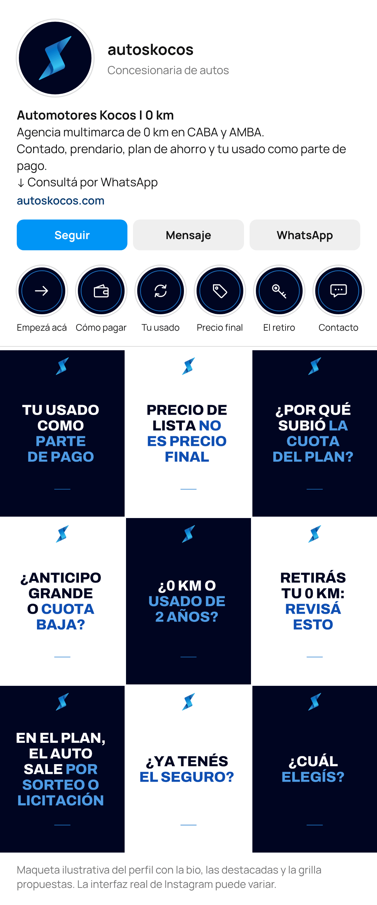

# Automotores Kocos · perfil profesional (@autoskocos)

Kit listo para cargar a mano o con Claude in Chrome. **No se publicó ni se cambió nada.** Guía general: [`../README.md`](../README.md).



## 1. Datos del perfil de Instagram

- **Nombre** (campo «Nombre», se busca en Instagram): `Automotores Kocos | 0 km` (24 caracteres; máximo 64).
- **Categoría:** Concesionaria de autos (o la más parecida que ofrezca la app).
- **Bio** (máximo 150 caracteres). Elegí una:

**Variante A** (132 caracteres):

```text
Agencia multimarca de 0 km en CABA y AMBA.
Contado, prendario, plan de ahorro y tu usado como parte de pago.
↓ Consultá por WhatsApp
```

**Variante B** (131 caracteres):

```text
Tu próximo 0 km, con todo claro.
Multimarca en CABA y AMBA: costos, trámites y formas de pago explicados.
↓ Escribinos por WhatsApp
```

## 2. Enlaces con UTM

Los enlaces dicen de qué red y de qué pieza viene cada visita. Las landings todavía no guardan estas etiquetas: sirven en cuanto se instale GA4 o la medición pendiente.

- **Bio de Instagram:** `https://www.autoskocos.com/?utm_source=instagram&utm_medium=bio&utm_campaign=autos`
- **Página de Facebook (sitio web):** `https://www.autoskocos.com/?utm_source=facebook&utm_medium=perfil&utm_campaign=autos`
- **Sticker de enlace en historias:** `https://www.autoskocos.com/?utm_source=instagram&utm_medium=historia&utm_campaign=autos&utm_content=destacada-<nombre>`
- **Segundo enlace de la bio, directo a WhatsApp** (Instagram admite hasta 5 enlaces): `https://wa.me/<número de WhatsApp de la marca, sin + ni espacios>?text=Hola%2C%20vengo%20de%20Instagram%20(ref%3A%20IG-BIO)`. El número es el de la landing y de `marcas.md`; no va escrito en ninguna imagen.

## 3. Página de Facebook

- **Presentación** (máximo 101 caracteres). Elegí una:
  - A (89): Agencia multimarca de 0 km en CABA y AMBA: contado, prendario, plan de ahorro y tu usado.
  - B (71): Tu 0 km con todo claro: costos, trámites y formas de pago. CABA y AMBA.
- **Descripción larga** (Información › Detalles). Elegí una:
  - A: Automotores Kocos es una agencia multimarca de 0 km en CABA y AMBA. Podés comprar de contado, con crédito prendario, con plan de ahorro o entregando tu usado como parte de pago, con asesoramiento en cada paso. Pedí siempre el precio llave en mano. Escribinos por WhatsApp desde el botón de la página.
  - B: ¿Buscás tu primer 0 km o querés cambiar el auto? Te explicamos costos, trámites y formas de pago sin apurarte. Contanos qué auto buscás por WhatsApp.
- **Botón de acción:** «Enviar mensaje de WhatsApp», con el número de la marca. Pasos en la guía general.
- **Sitio web:** el enlace de Facebook del punto 2.

## 4. Destacadas, en orden de recorrido

Todas las imágenes son de 1080 × 1920. Las que tienen versión `-guia` muestran en rosa dónde va el sticker de enlace: se publica la versión **sin** `-guia` y se pone el sticker encima de ese espacio.

| # | Destacada | Portada | Historias |
|---|---|---|---|
| 1 | Empezá acá (10) | `01-empeza-aca-portada.png` | `01-empeza-aca-historia-1.png`, `01-empeza-aca-historia-2.png`, `01-empeza-aca-historia-3.png` |
| 2 | Cómo pagar (10) | `02-como-pagar-portada.png` | `02-como-pagar-historia-1.png`, `02-como-pagar-historia-2.png`, `02-como-pagar-historia-3.png` |
| 3 | Tu usado (8) | `03-tu-usado-portada.png` | `03-tu-usado-historia-1.png`, `03-tu-usado-historia-2.png` |
| 4 | Precio final (12) | `04-precio-final-portada.png` | `04-precio-final-historia-1.png`, `04-precio-final-historia-2.png` |
| 5 | El retiro (9) | `05-el-retiro-portada.png` | `05-el-retiro-historia-1.png`, `05-el-retiro-historia-2.png` |
| 6 | Contacto (8) | `06-contacto-portada.png` | `06-contacto-historia-1.png`, `06-contacto-historia-2.png` |

Textos de cada historia (para revisar antes de publicar):

**1. Empezá acá**

1. Somos Automotores Kocos — Agencia multimarca de 0 km en CABA y AMBA, con asesoramiento en cada paso.
2. Cómo podés comprar: Contado; Crédito prendario; Plan de ahorro; Tu usado como parte de pago
3. Cómo seguir — Mirá las destacadas y, cuando quieras, contanos qué auto buscás por WhatsApp. · lleva sticker de enlace a WhatsApp

**2. Cómo pagar**

1. ¿Anticipo grande o cuota baja? — Antes de elegir, definí la cuota que podés pagar sin ahogarte y armá el resto alrededor.
2. ¿Por qué subió la cuota? — En un plan de ahorro, la cuota se calcula sobre el precio actual del auto: si sube el modelo, sube la cuota.
3. «Con el plan te dan el auto en la cuota 2, seguro.» Falso. El auto se adjudica por sorteo o licitación: nadie te puede garantizar en qué cuota te toca.

**3. Tu usado**

1. Tu usado como parte de pago. — Vale más con el service al día y sus comprobantes, los papeles en regla y sin deudas de patentes ni multas.
2. ¿0 km o usado de 2 años? — Depende de cuánto tenés hoy, cuánto podés pagar por mes y si tenés un usado para entregar.

**4. Precio final**

1. Precio de lista no es precio final. — En general se suman flete, formularios y patentamiento, sellos y seguro. Pedí siempre el precio llave en mano.
2. ¿Ya tenés el seguro? — Sin seguro no podés circular. Cotizá con tiempo, mirá qué cubre de verdad y llevá la póliza el día del retiro.

**5. El retiro**

1. Antes de retirar, revisá: Que el chasis coincida con los papeles; Que no tenga rayones ni golpes; Manual, llave de repuesto y kit
2. Cómo trabajamos: Nos contás qué auto buscás y cómo querés pagar.; Te pasamos la información y el precio llave en mano.; Te asesoramos en los trámites hasta el retiro.

**6. Contacto**

1. Escribinos por WhatsApp — Contanos qué auto buscás, si tenés un usado para entregar y cómo querés pagar. · lleva sticker de enlace a WhatsApp
2. Para escribirnos: Tocá el enlace de esta historia.; Contanos qué auto buscás.; Te respondemos por WhatsApp. · lleva sticker de enlace a WhatsApp

## 5. Portadas de reels y grilla

- `portadas-reels/plantilla-guia.png`: dónde va cada cosa. Rosa: lo que se ve en la grilla del perfil (3:4, de y = 240 a y = 1680). Celeste: el centro 1:1, que es lo que ven otras vistas. Amarillo: los botones del reel, donde no va nada importante.
- `portadas-reels/01.png` a `09.png`: portadas de muestra con los temas que mejor rindieron y las series. Sirven como portada propia del reel (se cargan en «Editar portada › Agregar desde la galería»).
- **Regla de la grilla:** se alternan portada oscura y clara (impares oscuras, pares claras), con el logo arriba al centro y el título en el centro. Así la grilla queda en damero, como en la maqueta.

## 6. Revisión pendiente

- Nombre: las piezas dicen «Automotores Kocos»; la landing dice «Agencia Kocos». Sigue abierta la contradicción de `marcas.md`.
- No se vio en una pantalla real: color en el teléfono y cómo recorta Instagram la portada de cada destacada (se elige y se ajusta el círculo al cargarla).
