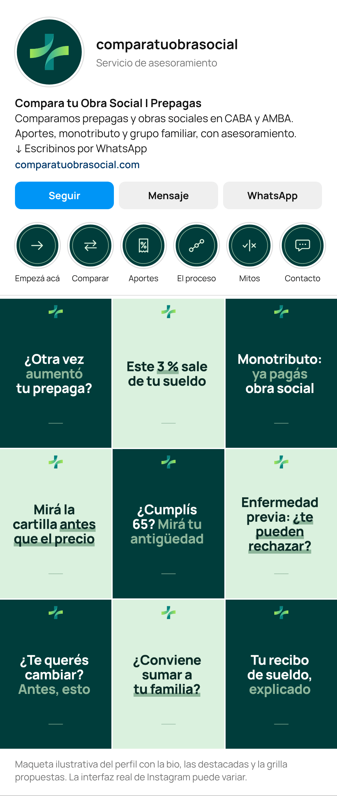

# Compara tu Obra Social · perfil profesional (@comparatuobrasocial)

Kit listo para cargar a mano o con Claude in Chrome. **No se publicó ni se cambió nada.** Guía general: [`../README.md`](../README.md).



## 1. Datos del perfil de Instagram

- **Nombre** (campo «Nombre», se busca en Instagram): `Compara tu Obra Social | Prepagas` (33 caracteres; máximo 64).
- **Categoría:** Servicio de asesoramiento (o la más parecida que ofrezca la app).
- **Bio** (máximo 150 caracteres). Elegí una:

**Variante A** (136 caracteres):

```text
Comparamos prepagas y obras sociales en CABA y AMBA.
Aportes, monotributo y grupo familiar, con asesoramiento.
↓ Escribinos por WhatsApp
```

**Variante B** (132 caracteres):

```text
¿Pagás mucho o no entendés tu cobertura?
Te ayudamos a comparar prepagas y obras sociales en CABA y AMBA.
↓ Consultanos por WhatsApp
```

## 2. Enlaces con UTM

Los enlaces dicen de qué red y de qué pieza viene cada visita. Las landings todavía no guardan estas etiquetas: sirven en cuanto se instale GA4 o la medición pendiente.

- **Bio de Instagram:** `https://www.comparatuobrasocial.com/?utm_source=instagram&utm_medium=bio&utm_campaign=coberturas`
- **Página de Facebook (sitio web):** `https://www.comparatuobrasocial.com/?utm_source=facebook&utm_medium=perfil&utm_campaign=coberturas`
- **Sticker de enlace en historias:** `https://www.comparatuobrasocial.com/?utm_source=instagram&utm_medium=historia&utm_campaign=coberturas&utm_content=destacada-<nombre>`
- **Segundo enlace de la bio, directo a WhatsApp** (Instagram admite hasta 5 enlaces): `https://wa.me/<número de WhatsApp de la marca, sin + ni espacios>?text=Hola%2C%20vengo%20de%20Instagram%20(ref%3A%20IG-BIO)`. El número es el de la landing y de `marcas.md`; no va escrito en ninguna imagen.

## 3. Página de Facebook

- **Presentación** (máximo 101 caracteres). Elegí una:
  - A (85): Comparamos prepagas y obras sociales en CABA y AMBA, con asesoramiento personalizado.
  - B (82): Te ayudamos a elegir prepaga u obra social: aportes, monotributo y grupo familiar.
- **Descripción larga** (Información › Detalles). Elegí una:
  - A: Compara tu Obra Social ayuda a asalariados, monotributistas y familias a comparar prepagas y obras sociales en CABA y AMBA: derivar aportes, sumar al grupo familiar y elegir un plan para tu edad y tu zona, con asesoramiento personalizado. Escribinos por WhatsApp desde el botón de la página.
  - B: ¿Te aumentó la cuota o no entendés qué cubre tu plan? Contanos tu situación por WhatsApp y un asesor te muestra las opciones para tu edad, tu trabajo y tu zona (CABA y AMBA).
- **Botón de acción:** «Enviar mensaje de WhatsApp», con el número de la marca. Pasos en la guía general.
- **Sitio web:** el enlace de Facebook del punto 2.

## 4. Destacadas, en orden de recorrido

Todas las imágenes son de 1080 × 1920. Las que tienen versión `-guia` muestran en rosa dónde va el sticker de enlace: se publica la versión **sin** `-guia` y se pone el sticker encima de ese espacio.

| # | Destacada | Portada | Historias |
|---|---|---|---|
| 1 | Empezá acá (10) | `01-empeza-aca-portada.png` | `01-empeza-aca-historia-1.png`, `01-empeza-aca-historia-2.png`, `01-empeza-aca-historia-3.png` |
| 2 | Comparar (8) | `02-comparar-portada.png` | `02-comparar-historia-1.png`, `02-comparar-historia-2.png`, `02-comparar-historia-3.png` |
| 3 | Aportes (7) | `03-aportes-portada.png` | `03-aportes-historia-1.png`, `03-aportes-historia-2.png`, `03-aportes-historia-3.png` |
| 4 | El proceso (10) | `04-el-proceso-portada.png` | `04-el-proceso-historia-1.png`, `04-el-proceso-historia-2.png` |
| 5 | Mitos (5) | `05-mitos-portada.png` | `05-mitos-historia-1.png`, `05-mitos-historia-2.png` |
| 6 | Contacto (8) | `06-contacto-portada.png` | `06-contacto-historia-1.png`, `06-contacto-historia-2.png` |

Textos de cada historia (para revisar antes de publicar):

**1. Empezá acá**

1. Somos Compara tu Obra Social — Te ayudamos a comparar prepagas y obras sociales en CABA y AMBA, con asesoramiento personalizado.
2. Con qué te ayudamos: Comparar prepagas y obras sociales; Derivar tus aportes; Sumar a tu grupo familiar; Elegir un plan para tu edad y tu zona
3. Cómo seguir — Mirá las destacadas y, cuando quieras, contanos tu situación por WhatsApp. · lleva sticker de enlace a WhatsApp

**2. Comparar**

1. ¿Otra vez aumentó? — Antes de pagar el aumento, compará: qué plan tenés, qué usás de verdad y qué opciones hay para tu edad y tu zona.
2. Lo descubriste en la guardia. — Antes de elegir por precio, mirá la guardia más cercana, los especialistas que usás y las farmacias adheridas.
3. ¿Te querés cambiar? Antes, esto. — Pedí la cartilla de tu zona, preguntá por las carencias y confirmá qué pasa con tus tratamientos en curso.

**3. Aportes**

1. Este 3 % sale de tu sueldo. — Si trabajás en relación de dependencia, el 3 % de tu sueldo va a tu obra social. Y la podés elegir.
2. Si sos monotributista, ya pagás obra social. — Una parte de la cuota del monotributo va a una obra social. Revisá a cuál, si sumaste a tu familia y qué cartilla tenés cerca.
3. ¿Conviene sumar a tu familia? — Puede convenir o no: depende de la edad, los aportes y lo que usa cada uno.

**4. El proceso**

1. Cómo trabajamos: Nos contás tu edad, tu trabajo, tu zona y tu grupo familiar.; Comparamos opciones que se ajusten a lo que usás.; Un asesor te muestra las opciones y vos decidís.
2. Qué tener a mano: Tu último recibo de sueldo o tu constancia de monotributo; Tu cobertura actual; Las edades de quienes querés sumar

**5. Mitos**

1. «Tengo una enfermedad previa. No me van a aceptar.» Falso. Por la ley de prepagas, una enfermedad preexistente no puede ser motivo de rechazo. Lo que sí puede cambiar es el valor de la cuota.
2. «Al cumplir 65 me van a aumentar por edad.» No siempre. Si tenés más de 10 años en la misma prepaga, al cumplir 65 no te pueden aumentar por edad.

**6. Contacto**

1. Escribinos por WhatsApp — Contanos tu edad, si trabajás en relación de dependencia o sos monotributista, y tu zona. · lleva sticker de enlace a WhatsApp
2. Para escribirnos: Tocá el enlace de esta historia.; Contanos tu edad, tu trabajo y tu zona.; Te respondemos por WhatsApp. · lleva sticker de enlace a WhatsApp

## 5. Portadas de reels y grilla

- `portadas-reels/plantilla-guia.png`: dónde va cada cosa. Rosa: lo que se ve en la grilla del perfil (3:4, de y = 240 a y = 1680). Celeste: el centro 1:1, que es lo que ven otras vistas. Amarillo: los botones del reel, donde no va nada importante.
- `portadas-reels/01.png` a `09.png`: portadas de muestra con los temas que mejor rindieron y las series. Sirven como portada propia del reel (se cargan en «Editar portada › Agregar desde la galería»).
- **Regla de la grilla:** se alternan portada oscura y clara (impares oscuras, pares claras), con el logo arriba al centro y el título en el centro. Así la grilla queda en damero, como en la maqueta.

## 6. Revisión pendiente

- Las afirmaciones jurídicas o de coberturas reutilizan textos que la responsable aprobó el 10/11, **sin revisión profesional**. La regla del proyecto pide revisión profesional o aprobación expresa antes de publicar.
- No se vio en una pantalla real: color en el teléfono y cómo recorta Instagram la portada de cada destacada (se elige y se ajusta el círculo al cargarla).
