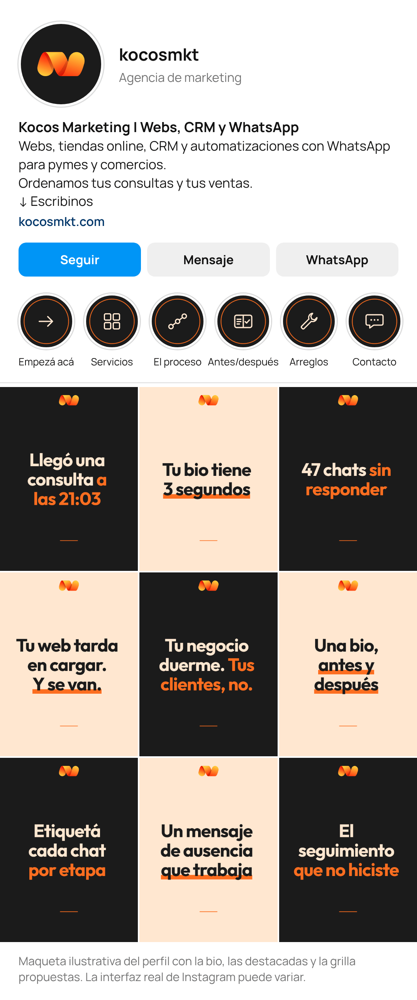

# Kocos Marketing · perfil profesional (@kocosmkt)

Kit listo para cargar a mano o con Claude in Chrome. **No se publicó ni se cambió nada.** Guía general: [`../README.md`](../README.md).



## 1. Datos del perfil de Instagram

- **Nombre** (campo «Nombre», se busca en Instagram): `Kocos Marketing | Webs, CRM y WhatsApp` (38 caracteres; máximo 64).
- **Categoría:** Agencia de marketing (o la más parecida que ofrezca la app).
- **Bio** (máximo 150 caracteres). Elegí una:

**Variante A** (132 caracteres):

```text
Webs, tiendas online, CRM y automatizaciones con WhatsApp para pymes y comercios.
Ordenamos tus consultas y tus ventas.
↓ Escribinos
```

**Variante B** (127 caracteres):

```text
¿Vendés por WhatsApp y redes?
Armamos tu web, tu CRM y respuestas automáticas para que no se te pierdan consultas.
↓ Escribinos
```

## 2. Enlaces con UTM

Los enlaces dicen de qué red y de qué pieza viene cada visita. Las landings todavía no guardan estas etiquetas: sirven en cuanto se instale GA4 o la medición pendiente.

- **Bio de Instagram:** `https://www.kocosmkt.com/?utm_source=instagram&utm_medium=bio&utm_campaign=kocos-marketing`
- **Página de Facebook (sitio web):** `https://www.kocosmkt.com/?utm_source=facebook&utm_medium=perfil&utm_campaign=kocos-marketing`
- **Sticker de enlace en historias:** `https://www.kocosmkt.com/?utm_source=instagram&utm_medium=historia&utm_campaign=kocos-marketing&utm_content=destacada-<nombre>`
- **Segundo enlace de la bio, directo a WhatsApp** (Instagram admite hasta 5 enlaces): `https://wa.me/<número de WhatsApp de la marca, sin + ni espacios>?text=Hola%2C%20vengo%20de%20Instagram%20(ref%3A%20IG-BIO)`. El número es el de la landing y de `marcas.md`; no va escrito en ninguna imagen.

## 3. Página de Facebook

- **Presentación** (máximo 101 caracteres). Elegí una:
  - A (81): Webs, tiendas online, CRM y automatizaciones con WhatsApp para pymes y comercios.
  - B (72): Ordenamos las consultas y las ventas de tu negocio: web, CRM y WhatsApp.
- **Descripción larga** (Información › Detalles). Elegí una:
  - A: Kocos Marketing arma páginas web, tiendas online, CRM y automatizaciones con WhatsApp e IA para pymes y comercios que venden por WhatsApp y redes. También hacemos sistemas a medida y gestión de redes. Escribinos por WhatsApp desde el botón de la página y contanos cómo vendés hoy.
  - B: ¿Te llegan consultas que se pierden o se responden tarde? Ordenamos tu WhatsApp, tu web y tus seguimientos para que vendas con orden. Escribinos y contanos tu negocio.
- **Botón de acción:** «Enviar mensaje de WhatsApp», con el número de la marca. Pasos en la guía general.
- **Sitio web:** el enlace de Facebook del punto 2.

## 4. Destacadas, en orden de recorrido

Todas las imágenes son de 1080 × 1920. Las que tienen versión `-guia` muestran en rosa dónde va el sticker de enlace: se publica la versión **sin** `-guia` y se pone el sticker encima de ese espacio.

| # | Destacada | Portada | Historias |
|---|---|---|---|
| 1 | Empezá acá (10) | `01-empeza-aca-portada.png` | `01-empeza-aca-historia-1.png`, `01-empeza-aca-historia-2.png` |
| 2 | Servicios (9) | `02-servicios-portada.png` | `02-servicios-historia-1.png`, `02-servicios-historia-2.png` |
| 3 | El proceso (10) | `03-el-proceso-portada.png` | `03-el-proceso-historia-1.png`, `03-el-proceso-historia-2.png` |
| 4 | Antes/después (13) | `04-antes-despues-portada.png` | `04-antes-despues-historia-1.png`, `04-antes-despues-historia-2.png` |
| 5 | Arreglos (8) | `05-arreglos-portada.png` | `05-arreglos-historia-1.png`, `05-arreglos-historia-2.png`, `05-arreglos-historia-3.png` |
| 6 | Contacto (8) | `06-contacto-portada.png` | `06-contacto-historia-1.png`, `06-contacto-historia-2.png` |

Textos de cada historia (para revisar antes de publicar):

**1. Empezá acá**

1. Somos Kocos Marketing — Webs, tiendas online, CRM y automatizaciones con WhatsApp para pymes y comercios.
2. Cómo seguir — Mirá las destacadas y escribinos por WhatsApp para contarnos tu negocio. · lleva sticker de enlace a WhatsApp

**2. Servicios**

1. Qué hacemos: Páginas web y tiendas online; CRM y WhatsApp ordenados; Automatizaciones con IA; Sistemas a medida y gestión de redes
2. Tu web tarda en cargar. Y se van. — Si tu web tarda 3 segundos en vez de 1, aumenta un 32 % la probabilidad de que la gente se vaya. (Fuente: Think with Google, 2017.)

**3. El proceso**

1. Cómo trabajamos: Nos contás cómo vendés hoy.; Te proponemos qué ordenar primero.; Lo armamos y te mostramos cómo usarlo.
2. Qué nos contás: Cómo te llegan hoy las consultas; Qué vendés y a quién; Qué te gustaría que pase solo

**4. Antes/después**

1. Una bio, antes y después: antes «Panadería artesanal. Consultas por privado.» / después «Panadería artesanal en Palermo. Pedidos del día por WhatsApp, de lunes a sábado.» (ejemplo ilustrativo)
2. Una respuesta, antes y después: antes «Hola, sí, tenemos. Pasá.» / después «¡Hola! Sí, tenemos. Abrimos de 8 a 20. ¿Querés que te lo reservemos para hoy?» (ejemplo ilustrativo)

**5. Arreglos**

1. 47 chats sin responder. — Etiquetá cada chat por etapa, armá respuestas rápidas y agendá cada seguimiento.
2. Tu negocio duerme. Tus clientes, no. — Mensaje de ausencia con horarios, respuestas a las preguntas de siempre y turnos o pedidos que no esperan a mañana.
3. Llegó una consulta a las 21:03. — Una consulta que llega a la noche y se responde al otro día muchas veces ya compró en otro lado.

**6. Contacto**

1. Escribinos por WhatsApp — Contanos qué vendés y cómo te llegan hoy las consultas. · lleva sticker de enlace a WhatsApp
2. Para escribirnos: Tocá el enlace de esta historia.; Contanos qué vendés.; Te respondemos por WhatsApp. · lleva sticker de enlace a WhatsApp

## 5. Portadas de reels y grilla

- `portadas-reels/plantilla-guia.png`: dónde va cada cosa. Rosa: lo que se ve en la grilla del perfil (3:4, de y = 240 a y = 1680). Celeste: el centro 1:1, que es lo que ven otras vistas. Amarillo: los botones del reel, donde no va nada importante.
- `portadas-reels/01.png` a `09.png`: portadas de muestra con los temas que mejor rindieron y las series. Sirven como portada propia del reel (se cargan en «Editar portada › Agregar desde la galería»).
- **Regla de la grilla:** se alternan portada oscura y clara (impares oscuras, pares claras), con el logo arriba al centro y el título en el centro. Así la grilla queda en damero, como en la maqueta.

## 6. Revisión pendiente

- El dato de velocidad web lleva su fuente (Think with Google, 2017). Los antes y después son ejemplos ilustrativos, no clientes.
- No se vio en una pantalla real: color en el teléfono y cómo recorta Instagram la portada de cada destacada (se elige y se ajusta el círculo al cargarla).
