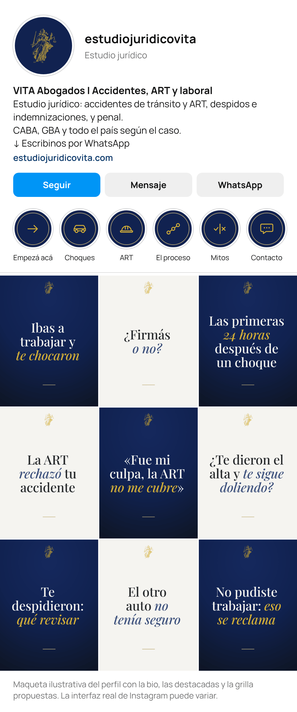

# VITA Abogados · perfil profesional (@estudiojuridicovita)

Kit listo para cargar a mano o con Claude in Chrome. **No se publicó ni se cambió nada.** Guía general: [`../README.md`](../README.md).



## 1. Datos del perfil de Instagram

- **Nombre** (campo «Nombre», se busca en Instagram): `VITA Abogados | Accidentes, ART y laboral` (41 caracteres; máximo 64).
- **Categoría:** Estudio jurídico (o la más parecida que ofrezca la app).
- **Bio** (máximo 150 caracteres). Elegí una:

**Variante A** (150 caracteres):

```text
Estudio jurídico: accidentes de tránsito y ART, despidos e indemnizaciones, y penal.
CABA, GBA y todo el país según el caso.
↓ Escribinos por WhatsApp
```

**Variante B** (139 caracteres):

```text
¿Te chocaron, te despidieron o tuviste un accidente de trabajo?
Abogados en tránsito, ART, laboral y penal.
↓ Contanos tu caso por WhatsApp
```

## 2. Enlaces con UTM

Los enlaces dicen de qué red y de qué pieza viene cada visita. Las landings todavía no guardan estas etiquetas: sirven en cuanto se instale GA4 o la medición pendiente.

- **Bio de Instagram:** `https://www.estudiojuridicovita.com/?utm_source=instagram&utm_medium=bio&utm_campaign=vita`
- **Página de Facebook (sitio web):** `https://www.estudiojuridicovita.com/?utm_source=facebook&utm_medium=perfil&utm_campaign=vita`
- **Sticker de enlace en historias:** `https://www.estudiojuridicovita.com/?utm_source=instagram&utm_medium=historia&utm_campaign=vita&utm_content=destacada-<nombre>`
- **Segundo enlace de la bio, directo a WhatsApp** (Instagram admite hasta 5 enlaces): `https://wa.me/<número de WhatsApp de la marca, sin + ni espacios>?text=Hola%2C%20vengo%20de%20Instagram%20(ref%3A%20IG-BIO)`. El número es el de la landing y de `marcas.md`; no va escrito en ninguna imagen.

## 3. Página de Facebook

- **Presentación** (máximo 101 caracteres). Elegí una:
  - A (97): Estudio jurídico: accidentes de tránsito, reclamos a la ART, despidos e indemnizaciones, y penal.
  - B (91): Estudio jurídico: tránsito, ART, despidos y penal. Te explicamos tus opciones con claridad.
- **Descripción larga** (Información › Detalles). Elegí una:
  - A: VITA Abogados acompaña a personas que tuvieron un choque o un accidente de trabajo, que discuten con la ART o con un seguro, que fueron despedidas o que necesitan un abogado penal. Te explicamos tus opciones con claridad y podés pedir que una abogada o un abogado del estudio revise tu caso. Accidentes de tránsito en CABA y GBA; accidentes laborales y ART en todo el país. Escribinos por WhatsApp desde el botón de la página.
  - B: ¿Te chocaron, tuviste un accidente de trabajo, te despidieron o tenés una causa penal? En VITA Abogados te escuchamos, te explicamos qué opciones hay y cómo seguir, sin vueltas ni promesas. Escribinos por WhatsApp: contanos qué pasó y cuándo.
- **Botón de acción:** «Enviar mensaje de WhatsApp», con el número de la marca. Pasos en la guía general.
- **Sitio web:** el enlace de Facebook del punto 2.

## 4. Destacadas, en orden de recorrido

Todas las imágenes son de 1080 × 1920. Las que tienen versión `-guia` muestran en rosa dónde va el sticker de enlace: se publica la versión **sin** `-guia` y se pone el sticker encima de ese espacio.

| # | Destacada | Portada | Historias |
|---|---|---|---|
| 1 | Empezá acá (10) | `01-empeza-aca-portada.png` | `01-empeza-aca-historia-1.png`, `01-empeza-aca-historia-2.png`, `01-empeza-aca-historia-3.png` |
| 2 | Choques (7) | `02-choques-portada.png` | `02-choques-historia-1.png`, `02-choques-historia-2.png`, `02-choques-historia-3.png` |
| 3 | ART (3) | `03-art-portada.png` | `03-art-historia-1.png`, `03-art-historia-2.png`, `03-art-historia-3.png` |
| 4 | El proceso (10) | `04-el-proceso-portada.png` | `04-el-proceso-historia-1.png`, `04-el-proceso-historia-2.png` |
| 5 | Mitos (5) | `05-mitos-portada.png` | `05-mitos-historia-1.png`, `05-mitos-historia-2.png` |
| 6 | Contacto (8) | `06-contacto-portada.png` | `06-contacto-historia-1.png`, `06-contacto-historia-2.png` |

Textos de cada historia (para revisar antes de publicar):

**1. Empezá acá**

1. Somos VITA Abogados — Estudio jurídico que acompaña casos de accidentes, trabajo y penal. Te explicamos tus opciones con claridad.
2. Qué hacemos: Accidentes de tránsito en CABA y GBA; Accidentes de trabajo y reclamos a la ART, en todo el país; Despidos e indemnizaciones; Derecho penal
3. Cómo seguir — Mirá las destacadas para entender tu situación. Cuando quieras, escribinos por WhatsApp. · lleva sticker de enlace a WhatsApp

**2. Choques**

1. Te chocaron. Las primeras 24 horas importan. — Fotos, datos del otro conductor, aviso a tu seguro dentro de los 3 días y, si te lastimaste, guardia y certificado.
2. No pudiste trabajar por el choque. Eso también se reclama. — Además del arreglo del auto, se reclaman los gastos médicos y de traslado, y los días que no pudiste trabajar.
3. ¿Firmás o no? — El seguro del otro puede ofrecerte un acuerdo rápido. Lo que firmás puede cerrar tu reclamo: pedilo por escrito, no firmes el mismo día y consultá antes.

**3. ART**

1. La ART rechazó tu accidente. — Todavía hay pasos: pedí el rechazo por escrito, seguí atendiéndote y presentate en la Comisión Médica con abogado.
2. ¿Te dieron el alta y todavía te duele? — Podés no estar de acuerdo: pedila por escrito, seguí con tus estudios y presentate en la Comisión Médica con abogado.
3. Ibas a trabajar y te chocaron. — Si fue en el trayecto habitual entre tu casa y el trabajo, también puede ser un accidente laboral. Avisá a tu empleador y a la ART, y guardá todo.

**4. El proceso**

1. Cómo trabajamos: Nos escribís y nos contás qué pasó.; Una abogada o un abogado del estudio revisa tu caso.; Te explicamos tus opciones y cómo seguir.
2. Qué tener a mano: Fotos y datos de lo que pasó; Avisos, denuncias o telegramas; Certificados y estudios médicos, si los hay

**5. Mitos**

1. «Si el accidente fue culpa mía, la ART no me cubre.» Falso. El sistema de riesgos del trabajo cubre aunque hayas cometido un error. Quedan afuera el daño hecho a propósito y la fuerza mayor ajena al trabajo.
2. «Si el otro no tiene seguro, no puedo reclamar.» Falso. Que el otro auto no tenga seguro no te deja sin reclamo: responden el conductor y el dueño del vehículo.

**6. Contacto**

1. Escribinos por WhatsApp — Contanos en un mensaje qué pasó y cuándo. Te decimos cómo seguir. · lleva sticker de enlace a WhatsApp
2. Para escribirnos: Tocá el enlace de esta historia.; Contanos qué pasó y cuándo.; Te respondemos por WhatsApp. · lleva sticker de enlace a WhatsApp

## 5. Portadas de reels y grilla

- `portadas-reels/plantilla-guia.png`: dónde va cada cosa. Rosa: lo que se ve en la grilla del perfil (3:4, de y = 240 a y = 1680). Celeste: el centro 1:1, que es lo que ven otras vistas. Amarillo: los botones del reel, donde no va nada importante.
- `portadas-reels/01.png` a `09.png`: portadas de muestra con los temas que mejor rindieron y las series. Sirven como portada propia del reel (se cargan en «Editar portada › Agregar desde la galería»).
- **Regla de la grilla:** se alternan portada oscura y clara (impares oscuras, pares claras), con el logo arriba al centro y el título en el centro. Así la grilla queda en damero, como en la maqueta.

## 6. Revisión pendiente

- Las afirmaciones jurídicas o de coberturas reutilizan textos que la responsable aprobó el 10/11, **sin revisión profesional**. La regla del proyecto pide revisión profesional o aprobación expresa antes de publicar.
- Laboral (despidos e indemnizaciones) y penal se sumaron el 20/11 por dato de la responsable, en términos generales. No hay todavía destacada propia de laboral ni de penal: se puede sumar cuando haya piezas revisadas.
- No se vio en una pantalla real: color en el teléfono y cómo recorta Instagram la portada de cada destacada (se elige y se ajusta el círculo al cargarla).
